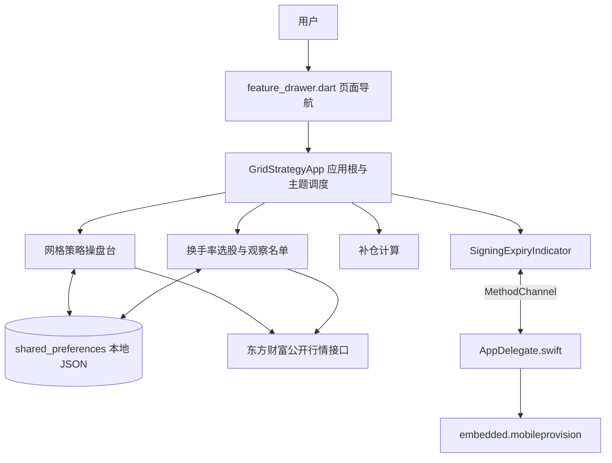

# Grid Strategy 技术文档

> 文档日期：2026-11-18  
> 项目：`grid_strategy_app`  
> 应用显示名称：Grid Strategy

## 1. 项目简介

这是一个使用 Flutter 编写的跨平台 A 股工具应用，提供网格策略操盘台、全市场换手率选股、次日观察名单复核和补仓成本计算。行情数据通过客户端直接请求东方财富公开行情接口；用户的策略、日志、快照和观察名单保存在设备本地。应用不连接券商账户，也不执行自动交易。

## 2. 技术栈与依赖

| 依赖 | 版本约束 | 锁定版本 | 用途 |
| --- | --- | --- | --- |
| Flutter SDK | 项目要求随 Flutter SDK | 由本机 Flutter 安装决定 | 跨平台 UI、应用构建及平台插件集成 |
| Dart SDK | `^3.13.2` | 由 Flutter SDK 决定 | 应用开发语言 |
| `http` | `^1.6.0` | `1.6.0` | 请求行情 HTTP 接口、超时与响应处理 |
| `shared_preferences` | `^2.5.5` | `2.5.6` | 将策略数据和观察名单 JSON 保存在本地偏好存储中 |
| `cupertino_icons` | `^1.0.8` | `1.0.9` | Cupertino 图标资源 |
| `flutter_lints` | `^6.0.0` | `6.0.0` | Dart/Flutter 静态代码规范 |
| `flutter_test` | Flutter SDK | 随 Flutter SDK | Flutter 测试工具，位于开发依赖 |

UI 使用 Flutter Material 3。iOS 签名期限功能使用 Flutter `MethodChannel` 与 iOS 原生 Swift 通信，不额外依赖第三方 Flutter 插件。完整的传递依赖和校验信息记录在 `pubspec.lock`。

## 3. 项目结构

```text
grid_strategy_app/
├── lib/
│   ├── main.dart                      # 应用入口、网格策略页面、模型、行情和本地持久化
│   ├── feature_drawer.dart            # 页面抽屉导航
│   ├── app_theme.dart                 # 浅色/深色主题与配色
│   ├── turnover_screener_page.dart   # 换手率扫描与次日观察名单
│   ├── averaging_calculator_page.dart # 补仓计算页面
│   └── signing_expiry_indicator.dart  # iOS 签名期限倒计时组件
├── assets/                            # 应用图标源文件
├── android/                           # Android 原生工程与启动图标
├── ios/                               # iOS Runner 工程、图标和 Swift 原生入口
├── macos/                             # macOS Runner 工程
├── web/                               # Flutter Web 外壳和图标
├── windows/                           # Windows Runner 工程
├── linux/                             # Linux Runner 工程
├── test/                              # Flutter 测试目录
├── pubspec.yaml                       # SDK 约束、依赖和 Flutter 资源配置
└── pubspec.lock                       # 解析后的依赖版本
```

当前没有单独的后端、数据库、服务层或数据仓库层。页面状态、业务计算和大部分请求流程分别由页面的 `StatefulWidget` 状态类管理。

## 4. 应用架构与数据流



### 页面路由

- `/grid`：网格策略操盘台，也是应用首页。
- `/turnover`：换手率选股和观察名单。
- `/averaging`：补仓计算。
- `AppFeatureDrawer` 使用命名路由切换页面，并清除上一页面路由栈。

## 5. 功能说明

### 5.1 网格策略操盘台

实现位于 `lib/main.dart`。

- 管理多只 A 股标的，可新增、切换和删除标的；初始示例标的为 `002402`、`600326` 和 `002639`。
- 刷新最新行情及日 K 收盘价，计算 MA20。
- 编辑持股数量、持仓成本，支持粘贴“持仓,成本价”格式的批量录入。
- 记录买入和卖出。买入后按加权方式更新持仓成本；卖出时按成交价与成本价计算已实现盈亏。股数要求为 100 股整数倍。
- 根据保存的基准价生成 `±2%`、`±4%`、`±6%` 网格；每档默认按 500 股估算。卖出建议会受可用持仓和 A 股整手数限制。
- 展示当前价相对 MA20 的策略信号、未实现盈亏、仓位建议和下一档网格价位。
- 支持手动保存和载入每日快照、查看成交记录和策略日志、重置当前标的账户数据。
- 行情失败时继续显示本地已有信息，并显示同步错误。

行情更新依次请求股票报价和日 K 数据，使用最近 20 个有效收盘价计算简单移动平均线。HTTP 请求超时设为 15 秒，对瞬时网络错误最多尝试三次。

### 5.2 换手率选股与次日观察

实现位于 `lib/turnover_screener_page.dart`。

- 按流通市值分为小盘（小于 50 亿元）、中盘（50 至 200 亿元）和大盘（200 亿元及以上），分别设置换手率门槛。默认值为 8%、10%、5%，可在页面调整。
- 从东方财富列表接口分页读取全市场 A 股报价，每页 100 条；对达标股票进一步请求日 K 数据。日 K 复核默认最多取 200 只，可调整，最多允许设置到 1000 只；日 K 请求分批并发处理。
- 对日 K 计算 MA5、MA10、MA20、20 日及 60 日涨幅、近 20 日均量倍数、前期高点和近期低点，并标注量价位置。
- 量价通过要求包括：最新成交量达到用户设置的均量倍数、收盘不低于开盘和 MA5、趋势过滤通过。只有收盘日 K 与当前日期匹配且收盘后（15:00 起）才标记为次日候选。
- 扫描结果只保留日 K 可用且量价条件通过的股票；可单只加入观察名单，也可批量加入通过的股票。
- 次日刷新分时快照，逐项检查现价与昨收、昨日 MA5、昨日 MA10、分时均价的关系，以及较日内低点反弹是否达到 0.5%。刷新建议在 09:45 后进行。
- 次日复核后移除未通过标的，保留通过项；相同交易日重复刷新不会重复增加连续通过天数。
- 观察名单保存在本地，展示连续通过天数、状态、最近价格和检查结果。提供回到列表顶部按钮。

行情列表每页 100 只，日 K 复核默认 200 只，属于扫描性能与请求量的配置，并不代表完整市场只包含这些股票。接口失败、数据缺失会记录在扫描状态中，相关错误不会被当作通过结果。

### 5.3 补仓计算

实现位于 `lib/averaging_calculator_page.dart`。

- 输入原持仓成本价、持股数、补仓价、补仓股数。
- 手续费、过户费、通信费为可选金额，留空按 0 计算；输入负费用或无效数值时不展示有效计算结果。
- 计算公式：

  ```text
  最终数量 = 原持股数 + 补仓股数
  最终总成本 = 原成本价 × 原持股数 + 补仓价 × 补仓股数 + 本次填写的费用
  最终成本价 = 最终总成本 ÷ 最终数量
  ```

- 数据仅在当前页面内存中编辑，不会保存到本地偏好存储。

### 5.4 自动日夜主题

实现位于 `lib/main.dart` 和 `lib/app_theme.dart`。

- 按北京时间（UTC+8）自动切换：07:00–18:59 为白天模式，19:00–次日 06:59 为黑夜模式。
- 应用保持运行时用定时器安排下一次切换；从后台恢复时重新读取时间并校准。
- 浅色和深色主题集中定义在 `AppPalette`，页面背景、卡片和主要文字色也按当前模式切换。

### 5.5 iOS 签名期限提示

实现位于 `lib/signing_expiry_indicator.dart` 和 `ios/Runner/AppDelegate.swift`。

- iOS 页面顶部显示签名剩余天数、小时或分钟；接近到期时使用警示色。
- Flutter 通过 `grid_strategy/signing` MethodChannel 请求原生代码读取应用包中的 `embedded.mobileprovision`，从其 plist 内容提取 `ExpirationDate`。
- 倒计时每分钟刷新，应用恢复前台时重新读取签名信息；点击提示可查看到期时间和剩余时长。
- 该功能按已签名安装包中的实际描述文件计算，不将“首次启动后 7 天”作为估算值。模拟器或不含该文件的包会显示“未知”。

## 6. 外部行情接口

应用直接使用东方财富公开行情 HTTP 接口，无应用自有代理服务器或鉴权服务。

| 用途 | 接口 |
| --- | --- |
| 个股实时/最新报价 | `https://push2.eastmoney.com/api/qt/stock/get` |
| 全市场股票列表 | `https://push2.eastmoney.com/api/qt/clist/get` |
| 日 K 与分钟 K | `https://push2his.eastmoney.com/api/qt/stock/kline/get` |

数据可用性、字段和访问策略由外部接口决定；行情可能延迟或请求失败。应用只提供筛选和计算工具，不是投资建议或下单终端。

## 7. 本地数据与隐私

- 网格策略数据使用 `grid_strategy_flutter_v1` 键保存为 JSON，包括所选标的、股票配置、持仓、日志和快照。
- 观察名单使用 `turnover_screener_watchlist_v1` 键保存为 JSON。
- 补仓计算输入不持久化。
- 数据由 `shared_preferences` 保存于当前设备，不提供账户登录、跨设备同步或云端备份。卸载应用或清除应用数据可能导致本地记录丢失。

## 8. 构建与运行

在项目根目录执行：

```bash
flutter pub get
flutter run
```

常用构建命令：

```bash
flutter build apk --debug
flutter build apk --release
flutter build ios --no-codesign
flutter build ios --simulator
```

版本号来自 `pubspec.yaml`，当前为 `1.0.0+1`。应用显示名称为 `Grid Strategy`。Android application ID 为 `com.toolsadmin.grid_strategy_app`；iOS Bundle ID 为 `com.toolsadmin.gridStrategyApp`。Android Release 目前仍使用 Gradle 的 debug signing 配置，正式分发前需要配置正式签名；iOS 真机安装需要可用的 Apple 签名配置。

iOS Deployment Target 为 15.0；Android 的 `minSdk` 和 `targetSdk` 使用 Flutter Gradle 插件提供的默认值，Android Java 与 Kotlin 编译目标为 JVM 17。仓库包含 macOS、Web、Windows 和 Linux Runner 工程；主要行情与签名功能以移动端（iOS/Android）使用为目标，其他平台的实际运行尚需按目标平台单独验证。

## 9. 维护提示

- 修改 Flutter 依赖后运行 `flutter pub get`，并检查提交时是否需要更新 `pubspec.lock`。
- 修改东方财富 API 字段、分页或复权参数时，应同步更新对应解析逻辑和扫描状态说明。
- 修改持久化模型字段时，需考虑旧版本 JSON 缺字段的兼容；当前反序列化多数字段提供默认值。
- 修改主题时间边界时，同时检查定时切换与应用恢复时的校准逻辑。
- iOS 签名期限代码依赖签名产物中包含 `embedded.mobileprovision`，本地模拟器包通常无法验证真机开发签名的有效期展示。
